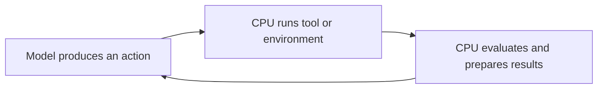

# NVIDIA Vera

**NVIDIA Vera** is an Arm-compatible data-center CPU built around NVIDIA's custom **Olympus** cores. It targets the CPU-heavy work surrounding AI models: agent sandboxes, tool execution, data processing, reinforcement-learning environments and orchestration, as well as hosting tightly coupled GPUs.

**Vera is the CPU; Rubin is the GPU; Vera Rubin is the combined platform.** A standalone Vera server is not automatically a GPU inference system or a Vera Rubin NVL72 rack.

---

## ⚙️ Key Specifications

NVIDIA-published capabilities reviewed in November 2026; maximum values and partner configurations are not guarantees for every server.

| Feature | Published capability | Interpretation |
|---|---|---|
| CPU cores | 88 custom Olympus cores | Physical CPU cores, not GPU streaming multiprocessors |
| Hardware threads | 176 with Spatial Multithreading | Two hardware threads per core, not 176 physical cores |
| Instruction set | Arm v9.2 compatible | Requires compatible AArch64 software/builds |
| L2 cache | 2 MB per core | Private/core-local cache capacity |
| Unified L3 cache | 164 MB | Shared through the on-die coherency fabric |
| Compute layout | Monolithic compute die | Avoids inter-compute-chiplet hops within the socket |
| System memory | Up to 1.5 TB LPDDR5X | CPU memory, distinct from attached GPU HBM |
| Memory modules | SOCAMM2 in the detailed architecture article | Field-replaceable LPDDR5X, not necessarily soldered-down memory |
| Memory bandwidth | Up to 1.2 TB/s aggregate | Socket-level peak, not guaranteed bandwidth for each thread |
| Scalable Coherency Fabric | Second generation; up to 3.4 TB/s bisectional bandwidth | Internal fabric metric, not DRAM or GPU-link bandwidth |
| NVLink-C2C | Second generation; up to 1.8 TB/s coherent bandwidth | CPU–GPU integration and supported CPU–CPU scale-up |
| Expansion interfaces | PCIe 6.x and CXL 3.1 | Actual lane allocation and exposed features depend on system design |
| Socket scaling | Single- and dual-socket systems | Dual socket presents two NUMA domains in NVIDIA's description |
| Confidential computing | Arm CCA/RME-based support | Platform security capability, not a complete sandbox policy |

The July architecture article specifies PCIe 6.4 and 176 PCIe lanes **for a dual-socket configuration**. Do not silently assign that lane count to one CPU or assume every server exposes all lanes as expansion slots.

---

## 🧠 Why Olympus Is Interesting

Vera follows NVIDIA Grace but changes from licensed Arm Neoverse cores to NVIDIA-designed Olympus cores while retaining Arm software compatibility.

NVIDIA describes Olympus as a wide, out-of-order design optimized for irregular, branch-heavy execution:

- **10-wide decode:** supplies a broad instruction stream to the execution machinery.
- **Advanced branch prediction:** reduces wasted work when execution paths are difficult to predict.
- **Large out-of-order window:** exposes independent work around memory and dependency stalls.
- **Memory/dependency acceleration:** targets pointer-heavy runtimes and long dependency chains.
- **Graph prefetching:** attempts to improve irregular graph/data-structure access.

These are architectural mechanisms, not proof that arbitrary Python programs or agents become proportionally faster. Instruction throughput, memory latency, contention and application structure still determine results.

See [[CPU Cache]] for the distinction between cache capacity, hit rate and main-memory access.

---

## 🧵 Spatial Multithreading

NVIDIA calls Vera's two-thread-per-core approach **Spatial Multithreading**, also abbreviated SMT. Its description emphasizes partitioning core resources to reduce interference between sibling threads rather than relying only on opportunistic sharing.

The design supports a tradeoff between per-thread progress and higher execution-context density. Useful examples include an agent's main tool task alongside runtime, networking or management work.

Important limits:

- Two hardware threads do not double physical execution resources or application performance.
- Reduced sibling interference is not zero contention across caches, memory, fabric or the operating system.
- Hardware-thread partitioning is not a replacement for VM/container isolation.
- “Predictable latency” in vendor material is not a hard-real-time deadline guarantee.

---

## 💾 Memory, Coherency and NUMA

Vera pairs high-bandwidth LPDDR5X with a coherent fabric connecting cores, cache, memory controllers, I/O and NVLink-C2C. SOCAMM2 provides serviceable memory modules without requiring conventional DDR5 DIMMs.

In a supported Vera Rubin system, NVLink-C2C provides coherent CPU–GPU memory access. This can help with large datasets, data staging and key-value cache offload.

**Coherent access does not make CPU LPDDR5X equivalent to GPU-local [[HBM]].** Capacity, locality, transfer bandwidth and access latency remain different. A shared address space does not remove placement and bandwidth decisions.

NVIDIA describes one NUMA domain per socket and two domains in a dual-socket server. Remote-socket memory still has a different access path; thread affinity and allocation locality remain relevant.

---

## 🤖 Agentic AI and Reinforcement Learning

[[Agentic Coding Loops]] alternate between model reasoning and actions such as compilation, Python execution, repository analysis and tests. GPU inference can finish quickly while the surrounding CPU work remains on the critical path.

Vera targets both fast individual steps and sustained per-thread progress when many sandboxes share a fully loaded server.

| Workload | Potential benefit | What still needs measurement |
|---|---|---|
| Coding-agent tools | Strong CPU execution and large working-set support | Wall time per task, concurrency and tail latency |
| CPU-based RL environments | Many active contexts and high memory bandwidth | Environment steps/s and policy/environment balance |
| Data preprocessing and analytics | Parallel CPU execution and bandwidth | Actual access pattern, I/O and cache behavior |
| GPU host/orchestration | Coherent data movement and CPU-side preparation | GPU idle time and full pipeline throughput |
| KV-cache offload | Additional coherent CPU-memory capacity | Latency, transfer volume and serving policy |

For [[PufferLib]] or other [[Vectorized Environments]], more available threads are useful only if the environments, native libraries and process model scale. GPU-resident simulation in [[Isaac Lab]] has a different bottleneck profile; changing the host CPU alone does not guarantee a large training speedup.

---

## 📊 Comparison with Other CPUs

These rows compare deployment roles, not measured performance or price-normalized rankings.

| Processor / family | Architecture and focus | Memory/platform distinction | Main tradeoff versus Vera |
|---|---|---|---|
| NVIDIA Vera | Custom Olympus Arm CPU; agents, RL and accelerator hosting | LPDDR5X SOCAMM2, coherent NVLink-C2C | Requires a suitable data-center platform and Arm software stack |
| NVIDIA Grace | Arm Neoverse V2; predecessor for accelerated/HPC systems | LPDDR5X and earlier NVLink-C2C generation | Different cores, thread model and memory/interconnect limits |
| AMD EPYC 9005 | x86 server CPU family | DDR5 server platforms and broad PCIe ecosystem | Conventional x86 deployment versus Vera's integrated memory/coherency approach |
| Intel Xeon 6 | x86 server CPU family with different core-oriented variants | Server memory/I/O configuration varies by model | Evaluate the exact CPU/system rather than a family-wide performance claim |
| [[Threadripper 7960X]] | x86 HEDT/workstation CPU | Socketed workstation and DDR5 RDIMM ecosystem | Workstation flexibility rather than a Vera-class integrated server platform |
| [[Ryzen AI Max Plus 395]] | x86 APU with integrated graphics/NPU | Shared LPDDR5x in compact workstation systems | Different capacity, expansion and deployment class; not a server substitute |

NVIDIA's Grace/Vera table lists 72 versus 88 physical cores, 72 versus 176 hardware threads, and up to 512 GB/s versus 1.2 TB/s CPU-memory bandwidth. Keep those CPU figures separate from whole-superchip or rack totals.

---

## 🏗️ Standalone CPU Versus Vera Rubin Systems

- **Standalone Vera:** CPU-centric agent execution, cloud services, analytics and RL environment workloads; a Rubin GPU is not mandatory for the CPU to be useful.
- **Vera Rubin Superchip:** NVIDIA documents one Vera CPU paired with two Rubin GPUs.
- **Vera Rubin NVL72:** 36 Vera CPUs and 72 Rubin GPUs, plus scale-up switching and network/infrastructure components.
- **Vera CPU rack:** a separate CPU-dense system offering; not another name for NVL72.

NVLink-C2C is the coherent chip/socket connection; NVLink 6 is also used for the GPU scale-up fabric. Do not interchange their bandwidth figures or treat every PCIe GPU attachment as an NVLink-C2C pairing.

Vera is not a consumer desktop CPU upgrade. Server implementation determines cooling, power delivery, serviceability, management and supported configurations.

---

## 🛠️ Software and Deployment Considerations

- Use supported Arm64 operating systems, libraries and container images; x86 binaries do not become native merely because both machines run Linux.
- Check native extensions, compiler flags, vector intrinsics, proprietary dependencies and [[C ABI]] compatibility.
- A container does not convert its userspace instruction set; select the correct image architecture.
- [[CUDA]] workloads still need a supported GPU, driver and application stack. The Vera CPU itself is not a CUDA GPU.
- Hardware confidential computing can help protect VM data in use, but agent tool permissions, network controls and filesystem sandboxing remain separate responsibilities.
- Size the entire pipeline: storage, networking, per-environment memory, GPU serving and CPU orchestration can each limit throughput.

---

## ✅ Strengths and Limits

**Strengths:** custom high-throughput CPU cores, substantial memory capacity/bandwidth, serviceable LPDDR memory, coherent accelerator integration and an explicit focus on loaded agent/environment execution.

**Limits:** data-center deployment requirements, Arm porting/validation work for some software, system-specific availability and pricing, and no automatic speedup for GPU-bound or poorly scaling workloads.

NVIDIA advertises **up to 1.8× faster agentic sandbox performance** against its selected x86 baseline. Treat this as a vendor-reported, workload/configuration-dependent result—not an independent universal ranking, twice the core count, or an equivalent gain in whole-system tokens/s.

The May 2026 announcement describes full production, and NVIDIA's August 2026 delivery report documents systems delivered to partners. Those reports do not prove every OEM configuration or cloud instance is generally available in a particular region.

No Vera hardware or benchmark was exercised for this note. Clock, power, pricing and orderability should come from the exact server/partner specification rather than estimates derived from memory bandwidth.

---

## 🔗 Related Notes

- [[CPUs]] — processor roles and deployment classes.
- [[PCIe]] — expansion links versus coherent proprietary interconnects.
- [[Agentic Coding Loops]] — the CPU-heavy side of model/tool iteration.
- [[PufferLib]] — environment throughput and CPU/GPU workload balance.
- [[HBM]] — accelerator memory versus CPU system memory.
- [[Docker]] — architecture-specific images and isolation boundaries.

---

## 📚 External Resources

- [NVIDIA Vera CPU product page](https://www.nvidia.com/en-us/data-center/vera-cpu/) — memory, cores, deployment roles and current headline claims.
- [NVIDIA Olympus architecture deep dive, July 2026](https://developer.nvidia.com/blog/inside-nvidia-vera-cpu-olympus-cores-built-for-maximum-single-threaded-performance-in-agentic-ai/) — core design, cache, Spatial Multithreading, SOCAMM2, NUMA and security.
- [NVIDIA platform architecture and Grace/Vera comparison](https://developer.nvidia.com/blog/inside-the-nvidia-rubin-platform-six-new-chips-one-ai-supercomputer/) — use the body/specification tables, not an old platform chip-count headline.
- [NVIDIA Vera Rubin NVL72 specifications](https://www.nvidia.com/en-us/data-center/vera-rubin-nvl72/) — CPU/GPU/superchip/rack boundaries; listed maxima remain subject to change.
- [NVIDIA Vera announcement, May 2026](https://nvidianews.nvidia.com/news/nvidia-unveils-vera-the-cpu-for-agents) and [partner delivery report, August 2026](https://blogs.nvidia.com/blog/vera-cpu-delivery/) — vendor availability statements, not region-specific procurement confirmation.
