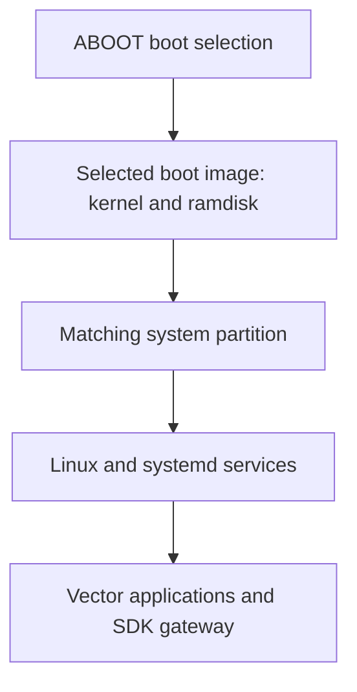

# Vector ABOOT

**Vector ABOOT** is the Android-derived bootloader component retained in [[Anki Vector]]'s embedded Linux boot path. Its role is below ordinary application processes: changing it is a boot/security operation, not a requirement for routine telemetry logging.

This note summarizes documented boundaries, not a complete Qualcomm boot-chain specification or flashing recipe.

---

## ⚙️ Where ABOOT Fits

The community partition reference describes ABOOT loading a selected boot image's kernel. The kernel runs init from the ramdisk, which brings up the matching system partition.

This is a deliberately simplified path. It omits earlier platform boot stages, signing details and board-specific recovery mechanisms that have not been established here.

---

## 🧩 Compare the Layers

| Layer | Responsibility | Ordinary IMU export work? |
|---|---|---|
| ABOOT | Bootloader-level selection/boot behavior | No |
| Recovery environment | Update/recovery operations | Not the telemetry producer |
| `boot_a` / `boot_b` | Kernel and ramdisk images | Usually unnecessary |
| `system_a` / `system_b` | Corresponding Linux system | May contain application files, but full-image replacement is not always needed |
| `/anki` applications | Robot behavior, control and public state export | Often the appropriate modification boundary |
| PC SDK client | Consume existing robot API | First choice if public measurements suffice |

ABOOT is not the STM32 body-controller firmware or the BLE cube firmware.

---

## 🔓 Unlocking Is a Separate Operation

The historical official OSKR instructions explicitly identify ABOOT and recovery modifications as dangerous. They warn that an interruption can prevent the robot from booting, because the recovery software being relied on is itself rewritten.

The currently documented generic production unlock is a different workflow from the historical per-device official OSKR image. Current availability does not make its installation temporary or establish a guaranteed rescue path.

[[Vector OSKR]] distinguishes these access categories. Neither SDK pairing nor an `ep` firmware suffix proves the bootloader is unlocked.

---

## 🛡️ Signing and Recovery Limits

The historical security analysis explains production signing/loader constraints. Its former conclusion that production unlocking was impossible is explicitly obsolete according to the maintainer's current README.

Use historical analysis to understand why arbitrary recovery loaders cannot simply be assumed acceptable—not to repeat obsolete impossibility claims.

The following do not independently prove recoverability:

- UART or USB test pads on the board.
- A generic Qualcomm flashing application.
- A downloaded factory image or loader with unknown provenance.
- A backup whose applicable restoration route has not been demonstrated.
- The existence of A/B system slots.

A/B slots do not duplicate every bootloader, factory, identity and recovery dependency. See [[Vector Partitions and Recovery]].

---

## 🧪 When Not to Touch ABOOT

Reading SDK acceleration/gyro, improving a PC recorder or exporting gyro history already received by the engine does not inherently require a bootloader change.

After suitable developer access and a compatible OS are established, [[Vector Firmware Development]] can focus on Linux applications. Application runtime overrides and rollback are different from undoing an earlier bootloader unlock.

Do not reflash boot components simply because their source or an OTA is available.

---

## 🔗 Related Notes

- [[Vector Firmware Architecture]] — what starts after the boot boundary.
- [[Vector WireOS]] — OS/application images and access categories.
- [[Vector IMU Telemetry]] — a higher-layer development target.
- [[GRUB]] — a different bootloader, useful for general comparison only.
- [[UEFI]] — general firmware/boot concepts, not Vector's documented boot mechanism.

---

## 📚 External Resources

- [Community partition/boot overview](https://os-vector.github.io/vector-docs/3.-Software-Architecture/partitions.html).
- [Historical official unlock warnings](https://support.anki.bot/article/571-detailed-unlock-steps).
- [Maintainer's current status correction](https://github.com/kercre123/unlocking-vector) and [historical security analysis](https://github.com/kercre123/unlocking-vector/blob/main/README-old.md).
- [Current community unlock workflow](https://unlock-prod.skittle.dev/) — documentation, not a procedure validated by this note.
