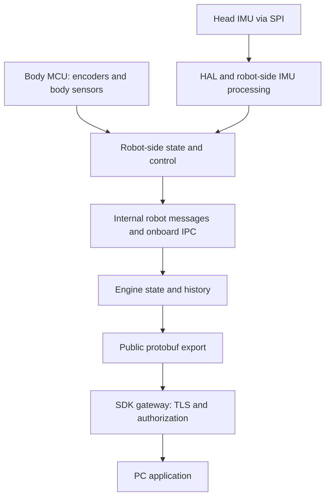

# Vector Firmware Architecture

Vector Firmware Architecture describes the hardware, Linux processes and message boundaries inside [[Anki Vector]]. It is a multiprocess embedded system, not one monolithic firmware executable.

Implementation details below use `wire-os-victor` commit `505eb84cfaa6ec01c075730f4be855e93713bb59`; historical Anki firmware and other community images may package components differently.

---

## ⚙️ Process Responsibilities

| Component | Main responsibility | Relevant development boundary |
|---|---|---|
| `vic-engine` | Perception, SLAM, world state and behaviors | Receives internal state and constructs public state |
| `vic-robot` | Lower-level control and hardware-facing robot logic | Acquisition/processing, controller and body-interface paths |
| `vic-anim` | Animation, audio, procedural eyes and related messaging | Engine-directed presentation and communication roles |
| SDK gateway | Authenticated public SDK requests/events | Public transport, authorization and routing |
| `vic-cloud` | Voice/backend, settings/authentication services | Includes gateway functionality in inspected WireOS |
| `update-engine` | OTA checking/installation | Separate from telemetry and ordinary SDK collection |
| STM32 body firmware | Body sensor/motor I/O | Separate MCU target, not a Linux daemon |

A separately running service named `vic-gateway` must not be assumed on every image: community architecture explicitly notes its merger into `vic-cloud` in WireOS.

---

## 📁 Application Filesystem

- `/anki/bin`: application executables.
- `/anki/lib`: application libraries.
- `/anki/etc`: configuration/environment files.
- `/anki/data`: application assets; the architecture reference describes resources beneath `assets/cozmo_resources`.

These are persistent application locations in the system filesystem. They are not automatically RAM staging areas or independent backups.

[[systemd]] manages the Linux services and targets. Unit names, effective overrides and runtime environment must be inspected on the actual selected image.

---

## 🔄 Internal Versus Public Dataflow

This is a measurement path, not a complete process topology. It does not imply every internal hop is lossless or that every sensor routes through the STM32.

[[IPC]] describes general communication mechanisms; the community architecture identifies Unix sockets between application processes. Internal CLAD definitions and public protobuf schemas are different contracts.

---

## 🧠 Information Can Disappear at Boundaries

The engine ingests latest head-frame acceleration/gyro and nonzero-timestamp robot-frame gyro history. Its public-state constructor exports the latest vectors, not that history array or the internal state timestamp.

Consequently:

- Public API absence does not prove the hardware lacks a measurement.
- A Python wrapper cannot reconstruct discarded samples or invent acquisition timing.
- Exporting data already at the engine is shallower than replacing the driver or body firmware.
- Adding a schema on the PC alone cannot make an old onboard producer populate it.

[[Vector IMU Telemetry]] traces these distinctions in detail.

---

## 🗺️ Source Map

| Path in application repository | What to inspect |
|---|---|
| `robot/hal/src/hal_imu.cpp` | IMU SPI acquisition, scaling and buffering |
| `robot/supervisor/src/imuFilter.cpp` | Bias correction, transformations, history and debug capture |
| `robot/supervisor/src/messages.cpp` | Internal state construction, invalid entries and scheduling |
| `robot/clad/src/clad/types/imu.clad` | Internal inertial data structures |
| `engine/robot.cpp` | State ingestion and public protobuf construction |
| `engine/robot.h` | Head-frame getter units and axes |
| `engine/components/sensors/imuComponent.cpp` | Engine-side history |
| `engine/robotToEngineImplMessaging.cpp` | Internal subscriptions and finite IMU log handlers |
| `tools/protobuf/gateway/public/messages.proto` | Public messages and state fields |
| `tools/protobuf/gateway/public/external_interface.proto` | Public RPC service schema |
| `cloud/cloud/gateway.go` | Gateway setup and security integration |
| `cloud/cloud/message_handler.go` | Request/event routing |
| `project/victor/scripts/deploy.sh` | Actual persistent deployment effects |

Paths are a source navigation map, not instructions to edit generated output or assume all targets need rebuilding for every change.

---

## 🛠️ Choose the Shallowest Sufficient Change

1. Public values sufficient: improve the PC recorder.
2. Internal engine data sufficient: add a bounded engine export.
3. Samples/timing missing upstream: extend acquisition/collection and internal transport.
4. Platform runtime changes needed: use the full OS build.
5. Body/cube controller changes needed: investigate those separate firmware targets.

Preserve control and safety semantics while observing measurements. The IMU processing path also participates in pickup/fall/motion detection; a logger is not justification to remove that logic.

---

## 🛡️ Updates and Network Boundaries

The community architecture describes timer-driven update checks and distinguishes backend communications from SDK communications. A local voice backend does not imply the robot never contacts any other service.

Adding a new telemetry RPC requires tracing authorization, gateway routing and engine handling. A registered method or reliable final network transport is not proof of full end-to-end authorization or lossless sampling.

---

## 🔗 Related Notes

- [[Vector Hardware]] — head/body sensor placement.
- [[Vector Firmware Development]] — builds, deployment and rollback.
- [[Vector SDK]] — client-visible API.
- [[Vector WireOS]] — full OS versus application construction.
- [[Vector Partitions and Recovery]] — boot and persistent storage boundaries.
- [[Protobuf]] — public schema/code generation concepts.

---

## 📚 External Resources

- [Community process/filesystem architecture](https://os-vector.github.io/vector-docs/3.-Software-Architecture/architecture.html).
- [Pinned application tree](https://github.com/os-vector/wire-os-victor/tree/505eb84cfaa6ec01c075730f4be855e93713bb59).
- [Engine ingestion and export](https://github.com/os-vector/wire-os-victor/blob/505eb84cfaa6ec01c075730f4be855e93713bb59/engine/robot.cpp).
- [Internal robot-to-engine contract](https://github.com/os-vector/wire-os-victor/blob/505eb84cfaa6ec01c075730f4be855e93713bb59/robot/clad/src/clad/robotInterface/messageRobotToEngine.clad).
- [Gateway implementation](https://github.com/os-vector/wire-os-victor/blob/505eb84cfaa6ec01c075730f4be855e93713bb59/cloud/cloud/gateway.go).
