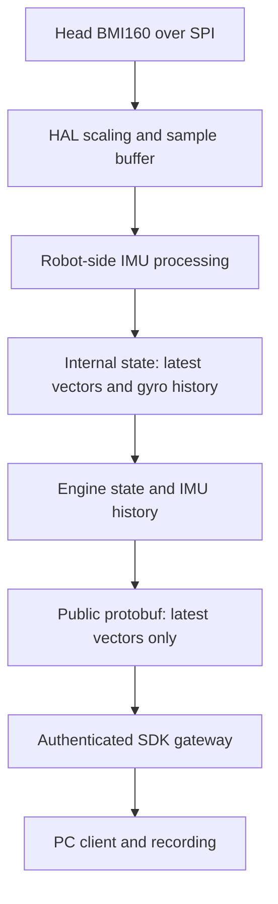

# Vector IMU Telemetry

Vector IMU Telemetry concerns which inertial measurements [[Anki Vector]] acquires, processes internally and exposes through [[Vector SDK]]. The useful firmware extension is better timing, frames, history and loss information—not simply adding an IMU API that already exists.

Implementation findings here refer to `wire-os-victor` commit `505eb84cfaa6ec01c075730f4be855e93713bb59`. They do not establish an exact match to an arbitrary installed production or Escape Pod image.

---

## ⚙️ What Already Exists

The public SDK exposes `robot.accel` and `robot.gyro`. The inspected public `RobotState` includes acceleration and gyro, but **no dedicated inertial-sample timestamp or internal gyro-history array**.

| Signal or timestamp | Where available in inspected source | Meaning / limitation |
|---|---|---|
| Latest acceleration | Internal and public state | Head-frame scaled vector, mm/s² |
| Latest gyro | Internal and public state | Head-frame gyro after bias correction; rad/s |
| Robot-frame gyro history | Internal robot state and engine history | Up to six slots per state; not a six-axis raw history |
| Latest raw integer sensor counts | Acquisition/debug-related paths | Different representation from public float state |
| Internal state timestamp | Robot-to-engine state | State assembly time, not necessarily each field's sample time |
| History-entry timestamp | Internal `IMUDataFrame` | 32-bit HAL milliseconds assigned during processing |
| `last_image_time_stamp` | Public state | Last processed image timestamp; **not an IMU timestamp** |

No firmware modification is needed merely to collect the already-public vectors from a working SDK connection.

---

## 🧠 Measurement Path

The body MCU is not an intermediate owner of every IMU read. The normal public export omits information already received by the engine.

More PC-side property reads cannot recover samples discarded earlier or force the onboard publication rate to increase.

---

## 🔬 Acquisition and Processing

The pinned `robot/hal/src/hal_imu.cpp`:

- Describes SPI access and calls `imu_manage`.
- Scales accelerometer counts into mm/s² and gyro counts into rad/s.
- Buffers samples and includes an explicit dropped-data warning.
- In its threaded mode, aims for 5 ms between processing calls.

That intended cadence is **not proof of 200 Hz acquisition-to-PC delivery**, hardware timestamp accuracy or lossless behavior under load.

`robot/supervisor/src/imuFilter.cpp` consumes the samples, estimates gyro bias, applies a gyro sensitivity correction in relevant builds, transforms frames and participates in pickup/fall/motion detection.

The robot-frame history stores `gyro_robot_frame_filt`. However, the pinned `RATE_FILT_COEFF` is `1`, documented there as disabling that low-pass stage. A variable named “filtered” does not establish an active smoothing filter in every build.

Do not remove shared filtering or change control outputs merely to obtain easier-to-log data.

---

## 🧭 Coordinate Frames and Units

The head-frame convention is X forward through the face, Y left and Z up from the head. The IMU moves with the head; chassis and head frames are not permanently identical.

- Public acceleration: **mm/s²**; divide by 1000 for m/s².
- Public angular velocity: **rad/s**; do not reinterpret it as degrees/s.
- Internal history: robot-frame gyro, following the source's transformation path.
- Head angle can help interpret geometry, but its presence in a state does not prove synchronization with every inertial sample.

Distinguish scaled sensor data, bias-corrected head gyro and transformed robot-frame history. None should be called “raw” without defining the processing already applied.

---

## ⏱️ Timestamp and Validity Rules

`IMUDataFrame` contains `uint_32 timestamp` and `gyroRobotFrame`. The producer assigns `HAL::GetTimeStamp()` while processing each sample. It is not established as the sensor's physical acquisition timestamp.

The state producer drains up to six queued entries and fills unused slots with a zero-timestamp invalid frame. The engine ignores those zero-timestamp entries. State publication scheduling also changes in calm mode.

A consumer must handle:

- Invalid slots and batches containing fewer than six valid entries.
- Variable delivery intervals, dropped batches and repeated observations.
- Millisecond quantization: different samples can share a processing timestamp; timestamp equality alone is not a safe duplicate identity.
- 32-bit millisecond rollover and reboot/session changes; these are different timeline events.
- Source processing time versus engine export time versus host monotonic receipt time.

Robot and host clocks are not automatically synchronized. Cross-device sample age requires a clock mapping and stated uncertainty; subtracting unrelated clock values is not valid.

Camera timestamp semantics must be traced separately. This export does not prove a hardware-synchronized camera/IMU stream or solve camera latency.

---

## 🛠️ Existing Finite Debug Capture

The source also contains `IMURequest`, `RecordAndSend(length_ms)`, `IMUDataChunk` and `IMURawDataChunk`.

Engine handlers write finite IMU captures to `.dat` files. The raw chunk has compact integer vectors and an **eight-bit timestamp field**, rather than the public float-state format.

This is an investigation lead, not a ready-made standard SDK raw-IMU RPC. Before reuse, establish the target build's trigger, packing/scaling, timestamp reconstruction, output permissions, storage bound and retrieval workflow.

Do not mistake an internal message definition for a remotely accessible authenticated API.

---

## 🧪 Proposed First Extension

**Design proposal, not an upstream feature or tested deployment:** export the gyro history the engine already receives before changing acquisition or the body MCU.

Use a bounded, off-by-default, finite diagnostic capture. The producer copies records into preallocated storage without waiting for disk or a network consumer. A separate drain writes a bounded capture or protected local socket; authenticated SSH can retrieve it.

| Record information | Why retain it |
|---|---|
| Schema/build and boot/session identity | Separate formats and reboot timelines |
| Sequence number | Identify exported records independently of timestamp quantization |
| Internal state time | Label state assembly explicitly |
| Per-entry time and validity | Preserve existing processing-time semantics |
| Frame, units and processing flags | Prevent mixing head/body or raw/processed signals |
| Producer/transport drop counters | Make losses observable without inventing missing samples |
| Host monotonic receipt time | Measure host-side delivery independently of robot time |

If full, drop telemetry under a declared policy and count the loss. A slow consumer must not stall sensing/control or grow memory without bound.

For full six-axis history or improved acquisition timing, extend the robot-side collection and internal messages as necessary. Public schema changes cannot invent missing source samples.

---

## 🔌 From Diagnostic Capture to SDK API

After validating semantics, choose a small state/event extension or a separately rate-limited authenticated telemetry stream.

The complete path includes producer/storage, internal messages if needed, public protobuf, generated C++/Go/Python bindings, engine/gateway routing and a matching client. Preserve field numbers; reserve removed fields and define absent timestamp/validity semantics.

Adding a PC `.proto` field does not make old firmware populate it. Binary wire compatibility is not proof of correct authorization, event filtering or application behavior.

Acceptance should include stationary recordings, correct frame/units, invalid entries, timestamp collisions, gaps, slow/disconnected consumers, bounded resources, ordinary SDK/camera operation and verified experiment teardown.

---

## 🔗 Related Notes

- [[Vector Hardware]] — IMU placement and resource limits.
- [[Vector Firmware Architecture]] — internal/public communication boundaries.
- [[Vector Firmware Development]] — temporary deployment and rollback.
- [[IMU]] and [[Sensor Fusion]] — general inertial concepts.
- [[Embedded Timing and Multi-Rate Control for RL]] — timing and buffering.
- [[Protobuf]] — schema and generated bindings.

---

## 📚 External Resources

- [Pinned IMU HAL](https://github.com/os-vector/wire-os-victor/blob/505eb84cfaa6ec01c075730f4be855e93713bb59/robot/hal/src/hal_imu.cpp) and [filter/history producer](https://github.com/os-vector/wire-os-victor/blob/505eb84cfaa6ec01c075730f4be855e93713bb59/robot/supervisor/src/imuFilter.cpp).
- [Internal IMU schema](https://github.com/os-vector/wire-os-victor/blob/505eb84cfaa6ec01c075730f4be855e93713bb59/robot/clad/src/clad/types/imu.clad) and [state construction](https://github.com/os-vector/wire-os-victor/blob/505eb84cfaa6ec01c075730f4be855e93713bb59/robot/supervisor/src/messages.cpp).
- [Engine ingestion/export](https://github.com/os-vector/wire-os-victor/blob/505eb84cfaa6ec01c075730f4be855e93713bb59/engine/robot.cpp) and [head-frame definitions](https://github.com/os-vector/wire-os-victor/blob/505eb84cfaa6ec01c075730f4be855e93713bb59/engine/robot.h#L424-L436).
- [Public state schema](https://github.com/os-vector/wire-os-victor/blob/505eb84cfaa6ec01c075730f4be855e93713bb59/tools/protobuf/gateway/public/messages.proto) and [legacy capture handlers](https://github.com/os-vector/wire-os-victor/blob/505eb84cfaa6ec01c075730f4be855e93713bb59/engine/robotToEngineImplMessaging.cpp#L449-L542).
- [Official protobuf evolution guidance](https://protobuf.dev/programming-guides/proto3/#updating).
