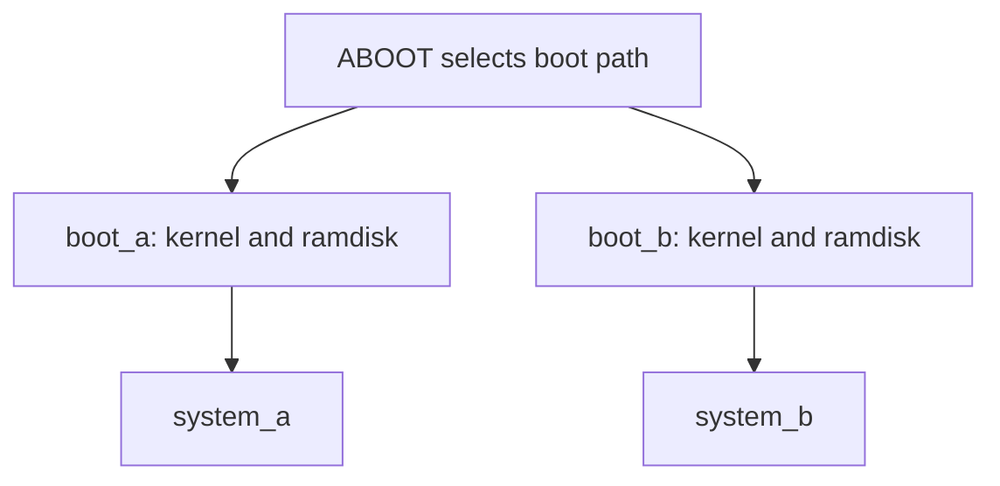

# Vector Partitions and Recovery

Vector Partitions and Recovery describes the persistent storage boundaries relevant to modifying [[Anki Vector]]. Boot slots, application files, user data and factory identity are different resources; a recovery action affecting one does not necessarily restore the others.

The community partition reference is an overview, not a complete flashing map. Do not derive raw write commands or partition offsets from this note.

---

## 💾 Documented Storage Areas

| Area | Documented contents / role | Why it matters |
|---|---|---|
| ABOOT | Android-derived bootloader | A boot-path change, not application logging |
| `boot_a`, `boot_b` | Kernel and ramdisk for each slot | Must correspond to the selected system slot |
| `system_a`, `system_b` | Linux system for the corresponding slot | Contains the OS/application environment |
| OEM mounted at `/factory` | Calibration logs and cloud identity material | Private and per-device |
| EMR | Calibration information, ESN, model and manufacturing/packout state | Not disposable scratch storage |
| `userdata` mounted at `/data` | Encrypted user information such as faces, images and settings | Persistent user data, not automatically executable or volatile |
| `/anki` within the system filesystem | Programs, libraries, assets and configuration | Application deployment can modify persistent bytes |

A mount path is not itself proof of a separate partition. In particular, `/anki` is documented as a directory on the system filesystem.

---

## 🧭 Simplified Slot Relationship

This explains corresponding slots, not an unconditional promise that an update is atomic or that either slot is currently usable.

The diagram does not show every boot/recovery partition or provide instructions for selecting a slot manually.

---

## 🔄 Recovery Actions Are Not Equivalent

| Action | What it can address | What it does not establish |
|---|---|---|
| Restart an application | Failed/stale process state | Old persistent binaries restored |
| Remove an experiment-owned runtime override | Return to the underlying service configuration | Removal of logs/settings written elsewhere |
| Ordinary reboot | Clear volatile process/runtime state | Undo application deployment or unlock |
| Restore a saved application tree | Replace known modified application files | Restore bootloader, identity or all dependencies |
| Supported OS update/recovery workflow | Install an appropriate OS image | Repair every hard-brick case |
| Clear user data | Remove/reset persistent user information | Restore bootloader or factory calibration |

Entering recovery and clearing user data are distinct operations in the community installation documentation. Do not treat a factory-reset label as a precise statement about every storage region.

---

## 🛡️ Why A/B Is Not a Full Backup

A/B boot/system slots do not create two independent copies of all factory data, identity, recovery components and bootloader state.

Replacing files in the active `/anki` tree does not automatically place a rollback copy in the inactive slot. An interrupted in-place application sync can leave a mixed tree even if the OS uses slots.

The historical official unlock warnings are especially important: the operation can rewrite the recovery software itself. A normal update's fallback assumptions must not be applied blindly to an unlock.

See [[Vector ABOOT]] and [[Vector OSKR]].

---

## 🔑 Per-Device Data

Preserve calibration, identity keys and device identifiers separately for each robot. Do not clone one robot's factory identity onto another to make a software experiment convenient.

Treat exported logs as potentially sensitive because they can contain identifiers or credentials. A general knowledge-base note should not contain actual robot keys, tokens or private calibration dumps.

The existence of a backup file proves only that bytes were saved. A useful recovery claim also needs:

- An applicable, understood restoration mechanism.
- Access and signing conditions that still hold in the failure state.
- The correct device/model and consistent image/dependency versions.
- Evidence that the restoration route works for the claimed failure class.

Some important material may not be accessible before unlocking. Document that limit rather than claim a complete pre-unlock backup.

---

## 🧪 Safer Experiment Boundary

For an application trial, leave the known-good persistent tree untouched where possible. Use bounded volatile staging and a narrowly owned runtime override only after verifying target support.

Record the exact mounts, files, overrides and persistent writes created. Verify immediate teardown separately from reboot rollback, then repeat normal SDK/camera observations.

No bootloader writes or firmware operation was performed to establish this note. No guaranteed consumer hard-brick recovery mechanism is asserted.

---

## 🔗 Related Notes

- [[Vector Hardware]] — generation and controller differences.
- [[Vector Firmware Development]] — persistent deployment versus temporary staging.
- [[Vector WireOS]] — choosing compatible images.
- [[tmpfs]] — volatile storage semantics.
- [[rsync]] — in-place writes, deletion and interruption.

---

## 📚 External Resources

- [Community partition overview](https://os-vector.github.io/vector-docs/3.-Software-Architecture/partitions.html).
- [Community software/filesystem architecture](https://os-vector.github.io/vector-docs/3.-Software-Architecture/architecture.html).
- [Historical official unlock/recovery warnings](https://support.anki.bot/article/571-detailed-unlock-steps).
- [WirePod installation distinctions](https://github.com/kercre123/wire-pod/wiki/Installation) — recovery versus clearing user data and production versus developer paths.
- [Pinned application deployment script](https://github.com/os-vector/wire-os-victor/blob/505eb84cfaa6ec01c075730f4be855e93713bb59/project/victor/scripts/deploy.sh).
