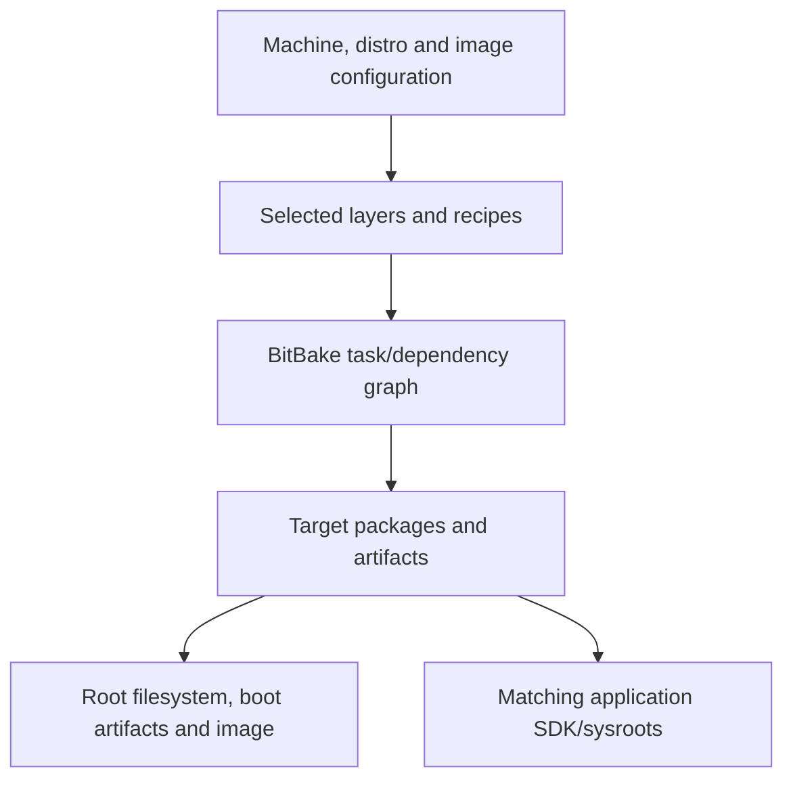

# Yocto Project

The **Yocto Project** is an open-source collaboration and toolset for building custom Linux-based systems, especially embedded products. It is **not one installable Linux distribution**: projects use its build tools, metadata and board support to produce their own images and SDKs.

It connects hardware-specific boot/kernel configuration with reproducible package builds, image composition and application cross-development.

---

## 🧩 Core Components

| Component | Role | Not the same as |
|---|---|---|
| BitBake | Executes metadata-defined build tasks and dependencies | A runtime package manager |
| OpenEmbedded-Core | Shared recipes/classes and core metadata | A complete product image policy |
| Poky | Reference distribution/integration environment | Every Yocto-based product |
| Recipe (`.bb`) | Source, configuration, build and packaging instructions | Only a shell build command |
| Append (`.bbappend`) | Extend/adjust a matching recipe | Editing upstream metadata in place |
| Layer (`meta-*` convention) | Organize related metadata and configuration | Automatically compatible with every release |
| BSP | Board/machine support metadata | A generic workstation compiler |
| SDK/eSDK | Target toolchain/sysroots and development tooling | Rebuilding/flashing the whole image for each application edit |

Layer names commonly begin with `meta-`, but that prefix is a convention rather than a requirement.

---

## ⚙️ How Builds Fit Together

Recipes describe fetching/unpacking sources, applying patches, configuring, compiling, installing into a staging area and producing packages. Image metadata selects the packages/features that become the target system.

Host tools and target binaries are different outputs. Being built on an x86 workstation does not make the target application x86.

---

## 🗂️ Machine, Distro and Image Policy

- **Machine/BSP configuration:** CPU tuning, board support, kernel/boot choices and hardware constraints.
- **Distro configuration:** product-wide policy such as libc, init system and feature selections.
- **Image configuration:** packages and filesystem/image features to include.
- **Layers:** separate hardware, product, middleware and application customizations.

Use an appropriate append or product layer instead of carrying unexplained local edits to upstream recipes. Keep layer branches compatible with the selected release and review overrides/recipe matching during upgrades.

---

## 🛠️ Application Iteration Versus Image Integration

A matching SDK provides the compiler, target headers/libraries and environment for application cross-development. An extensible SDK adds integration-oriented tooling such as `devtool`.

A product can also document a standalone application build against a compatible installed base, as [[Vector WireOS]] does. Application deployment still has its own persistence and rollback semantics.

The existence of generated packages does not imply the target image includes runtime package management. That is an image configuration choice.

[[CMake]] can build an application within this ecosystem; it does not replace the image build system or BSP.

---

## 🔁 Reproducibility and Caches

Record source revisions, all selected layer revisions, submodules, configuration, patches, toolchain and dependency inputs. A main repository commit alone is not a complete reproducible environment.

- Download caches avoid fetching sources repeatedly.
- Shared-state (`sstate`) caches reuse compatible task outputs.
- Task signatures/dependencies determine reuse; a cache hit is not hardware validation.
- Reproducible output does not prove correct behavior, secure configuration or legal redistribution rights.
- License manifests support review, but do not grant rights to proprietary inherited components.

Do not indiscriminately delete caches or build trees to hide an unexplained environment mismatch.

---

## 📊 Compare Build Approaches

| Approach | Main deliverable | Useful when | Main tradeoff |
|---|---|---|---|
| Yocto/OpenEmbedded | Customized Linux images, packages and SDKs | Product-specific BSP, policy and lifecycle | Metadata/release complexity and build resources |
| Buildroot | Embedded root filesystem/toolchain/images | Relatively direct appliance construction | Different package/update and integration model |
| General Linux distribution | Maintained binary package environment | Supported hardware and distribution policy fit | Less minimal/product-specific control by default |
| OpenWrt | Network-device-oriented Linux firmware | Router/network appliance ecosystem fits | Platform/package scope differs |
| Nerves | Elixir-oriented embedded system workflow | BEAM-centered devices | Application ecosystem constraints |
| Application build system | Executable/library | Base OS is already appropriate | Does not construct the whole supported platform |

These are different abstraction levels, not interchangeable command syntaxes.

---

## ⚠️ Practical Limits

Large initial builds consume substantial disk, RAM and time. Use the chosen release's supported host requirements; avoid importing setup commands from a different release blindly.

Host package installation, containers, emulator configuration and global Python changes are separate environment decisions. A build guide is not permission to alter a working workstation silently.

Simulator/emulator success can validate portions of software integration but not physical drivers, timing or recovery. Deploy target-matching artifacts through an explicit restoration plan.

No Yocto build was run to establish this conceptual note.

---

## 🔗 Related Notes

- [[Vector Firmware Development]] — application/OS boundaries in a concrete robot.
- [[Linux]] and [[systemd]] — target runtime components.
- [[C ABI]] and [[GLIBC]] — cross-target binary compatibility.
- [[Docker]] — host build isolation, not a compatibility guarantee.
- [[QEMU]] — emulation and integration limits.
- [[Nerves]] — another embedded product workflow.

---

## 📚 External Resources

- [Official Yocto introduction and layer model](https://docs.yoctoproject.org/overview-manual/yp-intro.html).
- [Official Yocto documentation](https://docs.yoctoproject.org/) — select the release matching the product rather than assume the moving default manual applies.
- [Layer index](https://layers.openembedded.org) — discover metadata and check release compatibility.
- [WireOS full-image build](https://github.com/os-vector/wire-os/blob/main/README.md) — one product-specific use, not generic Yocto policy.
